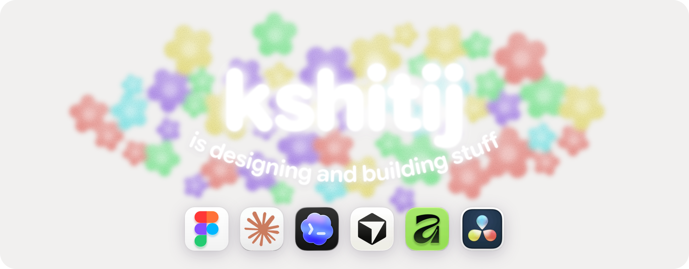
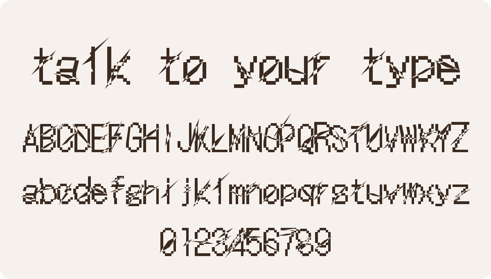

### hey, i'm kshitij

designer, building stuff here :)  
ux, ui, graphics and a lot of music.

 

  

**building noddy rn.** an open-source font editor where you talk to your type and an agent draws it with you, live. you can still grab the pen and fix any letter yourself.

- **remix mode:** style one letter, the agent carries the idea across the whole set
- **chaos tools:** slash cuts, glitch bands, warps, pixel life. no ai, just seeds
- **works with claude code:** it drives the editor over mcp, every change lands as a draft you keep or toss

still in development, so things break sometimes. that's half the fun.

**[try it →](https://github.com/kshitij0299/noddy)**

 

#### made with noddy

<picture>
  <source media="(prefers-color-scheme: dark)" srcset="assets/slash-gothic-dark.svg">
  
</picture>

slash gothic, a remix of DotGothic16 (OFL). one hand-drawn 51° slash on the A, then the agent ran with it across all 62 letters and figures.

 

#### elsewhere

[kshitij.wiki](https://www.kshitij.wiki/)
